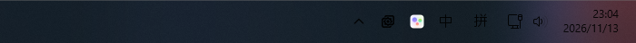
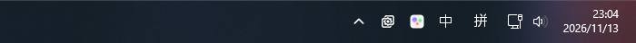

# Taskbar Contrast

Keep the taskbar text readable when the taskbar is transparent.

If you use [TranslucentTB](https://github.com/TranslucentTB/TranslucentTB) (or any transparent-taskbar
tweak), the taskbar loses its solid background but its text keeps the colour of your Windows theme —
dark text in **Light** mode, white text in **Dark** mode. As soon as the desktop colour behind the
taskbar gets close to that text colour, the clock, tray icons and task titles become unreadable.

This small watcher samples the taskbar itself every 1.2 s and flips the *Windows* light/dark mode so the
text is always the opposite brightness of what is behind it.

| Before — light mode, dark glass behind the bar | After — dark mode, white text |
|---|---|
|  |  |

*(Real screenshots from a 2560×1440 desktop with TranslucentTB. Same wallpaper, same bar, only the text colour changed.)*

## How it works

Windows has no "taskbar text colour" setting. Taskbar text follows `SystemUsesLightTheme`:

| `SystemUsesLightTheme` | Taskbar text |
|---|---|
| `1` (Light) | black |
| `0` (Dark) | white |

The script looks at **where the text actually is**: in Windows 11 the taskbar only renders text on its
right side (clock, date, tray icons, IME indicator), so `ZoneWidth` pixels at the right end are captured,
a luminance histogram is built and the **median** is used. The median ignores the glyphs drawn on top of
it, so it tracks the real background brightness behind the text. Sampling the whole bar would be wrong:
a dark window on the left half can drag a full-width average down while the clock sits on bright
wallpaper.

```
median >= 0.58  ->  Light mode  (black text)
median <= 0.44  ->  Dark mode   (white text)
in between      ->  keep current mode  (dead zone)
```

To stay calm on animated wallpapers (Wallpaper Engine, slideshows) and on window switches it also takes
the median of the last `WindowSize` (=5) samples, requires two identical verdicts in a row and a 10 s
cooldown between real switches.

The change is applied by writing `SystemUsesLightTheme` under
`HKCU\Software\Microsoft\Windows\CurrentVersion\Themes\Personalize` and broadcasting
`WM_SETTINGCHANGE` / `ImmersiveColorSet`. Explorer repaints the taskbar immediately — **no
`explorer.exe` restart**, no logoff.

### What it does *not* touch

Only `SystemUsesLightTheme` is changed. `AppsUseLightTheme` is left alone, so Chrome, VS Code,
Explorer windows, etc. keep whatever app theme you chose. The visible side effect is that the Start
menu, notification centre and system flyouts follow the same light/dark switch, because that is the only
lever Windows exposes. There is no way to recolour the taskbar text alone.

## Requirements

* Windows 10 / 11
* Windows PowerShell 5.1 (built in)
* No administrator rights, no external modules, no compiled binaries

## Install

```powershell
git clone https://github.com/Archettee/taskbar-contrast.git
cd taskbar-contrast
powershell -NoProfile -ExecutionPolicy Bypass -File .\install.ps1
```

`install.ps1` stops any running copy, drops a shortcut into your Startup folder
(`%APPDATA%\Microsoft\Windows\Start Menu\Programs\Startup\TaskbarContrast.lnk`) that launches
`wscript.exe start-hidden.vbs` (no console window), and starts it right away.

## Usage

```powershell
$s = ".\TaskbarContrast.ps1"

# run once, decide now, exit
powershell -NoProfile -ExecutionPolicy Bypass -File $s -Once

# status / stop
powershell -NoProfile -ExecutionPolicy Bypass -File $s -Stop

# force one mode and exit (stops fighting the watcher only until it re-checks)
powershell -NoProfile -ExecutionPolicy Bypass -File $s -Force light   # black text
powershell -NoProfile -ExecutionPolicy Bypass -File $s -Force dark    # white text

# diagnostics: print the sampled luminance and the verdict, change nothing
powershell -NoProfile -ExecutionPolicy Bypass -File $s -Probe
powershell -NoProfile -ExecutionPolicy Bypass -File $s -SelfTest

# start the background watcher again
wscript .\start-hidden.vbs
```

Log: `taskbar-contrast.log` next to the script (rotated at 512 KB).

## Tuning

Open the `$Cfg` block at the top of `TaskbarContrast.ps1`:

| Key | Default | Meaning |
|---|---|---|
| `IntervalMs` | `1200` | sampling period in ms; lower = faster reaction, more CPU |
| `CooldownMs` | `10000` | minimum time between two real switches; raise if it flips too often |
| `WindowSize` | `5` | how many recent samples are median-filtered |
| `ZoneWidth` | `460` | width of the sampled right-hand text zone in px |
| `BrightAbove` | `0.58` | smoothed luminance at/above this is a bright bar → black text |
| `DarkBelow` | `0.44` | smoothed luminance at/below this is a dark bar → white text |
| `NeedSamples` | `2` | consecutive matching verdicts required; raise for a calmer, slower watcher |

After editing, run `-Stop` and start it again with `wscript .\start-hidden.vbs`.

## Uninstall

```powershell
powershell -NoProfile -ExecutionPolicy Bypass -File .\uninstall.ps1
```

This stops the watcher and deletes the Startup shortcut. Your current Windows theme is left as it is.

## Notes and limits

* **Primary monitor only.** A taskbar on a secondary monitor with a different background is not sampled.
* The sampler reads the bar *as drawn*, so if you later switch TranslucentTB to a light tint, the script
  follows automatically — no config change needed.
* If you change your Windows light/dark mode by hand, the watcher will re-correct it within a few
  seconds. That is by design: it treats the bar's own brightness as the source of truth.
* Costs about 1.5 % of one CPU core and ~100 MB RAM (PowerShell host + GDI+). If you want it lighter,
  raise `IntervalMs` to 2000.

## License

[MIT](LICENSE)

---

[中文说明](README.zh-CN.md)
